# YM CF 面板 · 多账号 Cloudflare 用量与资源总览

把你名下**多个 Cloudflare 账号**的用量装进一个面板：Workers / Pages 函数、KV、D1、R2 的用量与免费额度进度、名下域名的流量与来源国家、以及全部资源清单，一页看全。部署在 Cloudflare Pages 上，**全程免费**，数据只经过你自己的账号。

> 本仓库只包含代码，不包含任何人的账号数据。截图与教程里的账号、域名、数字均为演示数据。

## 🌟 版本亮点（v1.0）

- 👥 **多账号汇总**：添加任意多个 Cloudflare 账号，首页一张卡一个账号，顶部还有全账号汇总
- 📊 **五大产品用量**：Workers 请求/错误/子请求、Pages 函数请求（自动从脚本里拆分）、KV 读/写/删/列、D1 行读/写与查询数、R2 A/B 类操作与存储量
- 🎚️ **免费额度进度条**：今日视图对照每日免费额度（Workers 10 万/天、KV 读 10 万/写 1000、D1 行读 500 万/写 10 万），30 天视图对照 R2 月额度（A 类 100 万、B 类 1000 万、存储 10 GB），快用满一眼可见
- 🌐 **站点流量分析**：名下全部域名的总请求、总流量和来源国家 Top 榜（类似官方控制台的账户分析概览）
- 🧰 **资源清单**：每个账号的域名、Workers 脚本、Pages 项目、D1 数据库、KV 命名空间、R2 存储桶一屏列全
- 📈 **请求趋势**：今日按小时、7/30 天按天的请求走势小图
- 🔒 **令牌安全**：API 令牌只存你自己的 KV、只在服务端调用官方接口、页面永不回显；面板后台是服务端登录（盐值哈希 + HttpOnly 会话），不是前端假密码
- 🌓 深/浅双主题、移动端适配、无任何外部 CDN 依赖（国内网络也能秒开）

## 📸 效果预览

| 桌面端 · 总览 | 账号详情 |
| --- | --- |
| 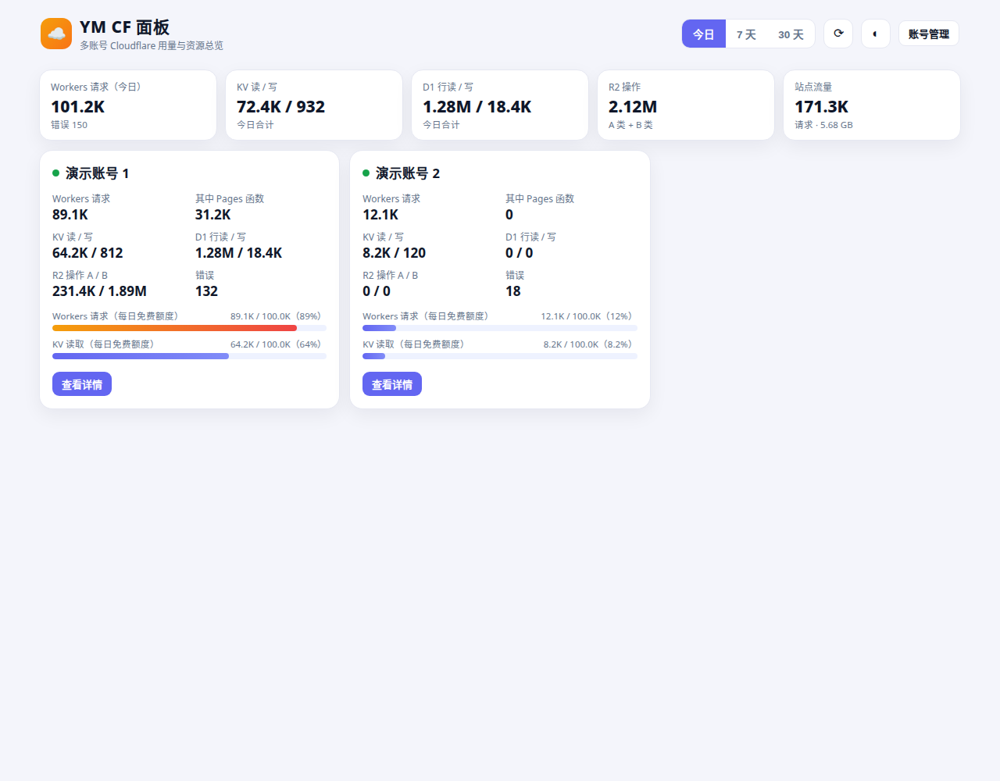 | 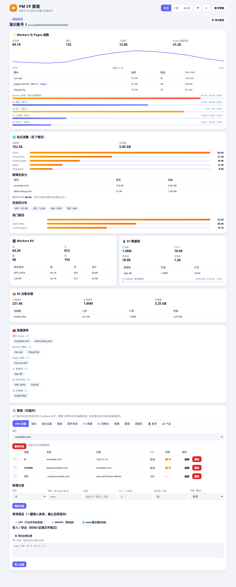 |

| 深色模式 | 移动端 |
| --- | --- |
| 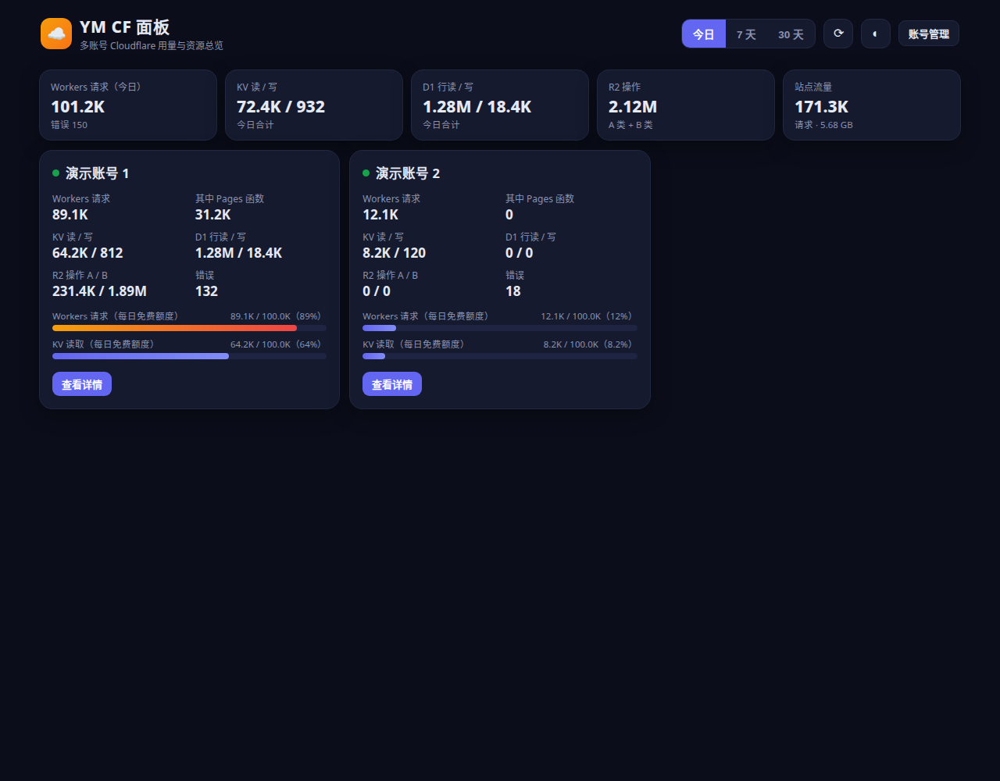 | 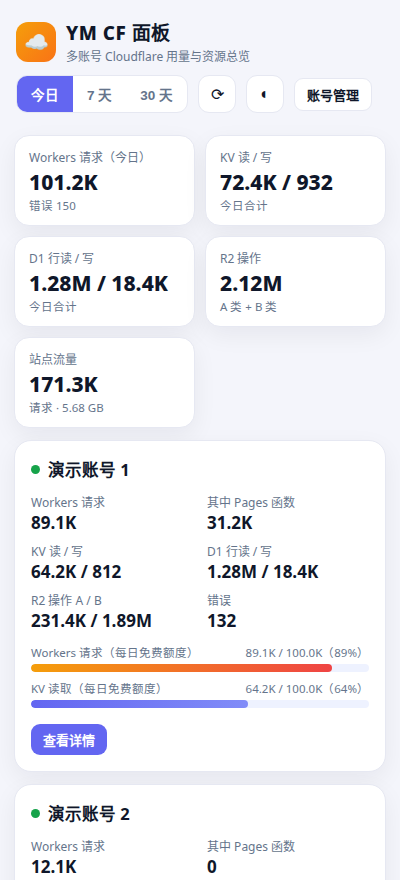 |

## 🚀 快速部署

面板由三部分组成：页面代码（本仓库）+ 一个 KV 命名空间（存账号与设置）+ Pages 项目（托管运行）。三种部署方式任选其一，**推荐方式一**。

### 方式一：Pages 连接 GitHub（推荐，自动更新）

1. **Fork 本仓库**到你的 GitHub 账号。
2. **创建 KV**：Cloudflare 控制台 → 存储和数据库 → KV → 创建命名空间，名字随意（如 `cf-panel-data`）。
3. **创建 Pages 项目**：Workers 和 Pages → 创建 → Pages → 连接到 Git → 选你 Fork 的仓库；框架预设选「无」，构建命令与输出目录留空，保存并部署。
4. **绑定 KV（关键）**：Pages 项目 → 设置 → 绑定 → 添加 → KV 命名空间：变量名称必须填 **`PANEL_KV`**，选第 2 步的命名空间；保存后重新部署一次。
5. 打开 `*.pages.dev` 域名，点右上角**「设置管理员」**设好后台账号密码，即可开始添加 CF 账号。

<details>
<summary>📸 部署图片教程（点开看图，6 步）</summary>

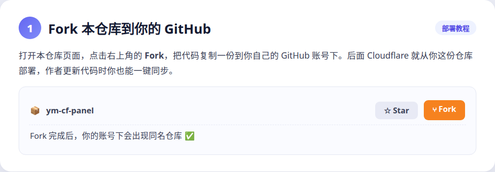
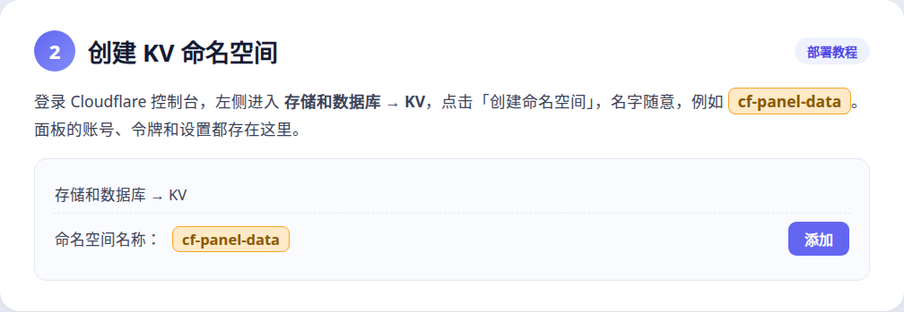
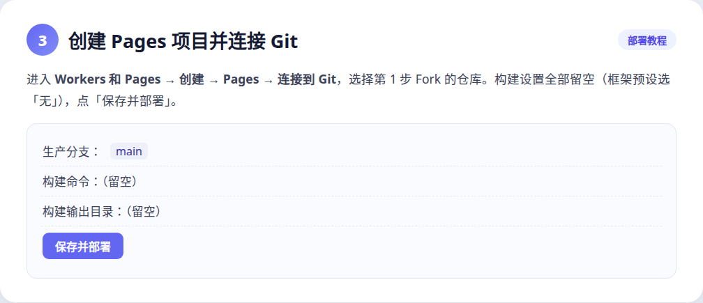
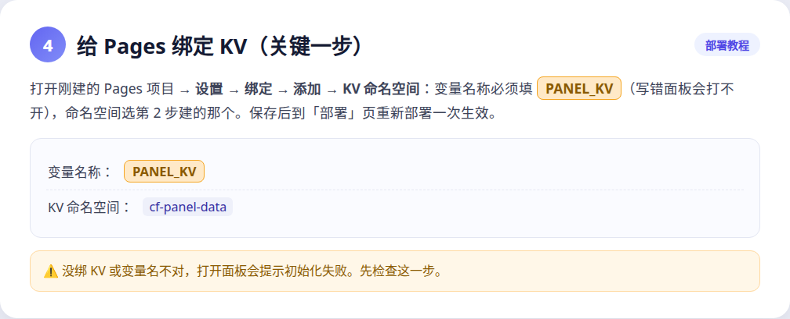


</details>

### 方式二：Pages 直接上传

1. 下载本仓库的压缩包（GitHub 仓库页 → Code → Download ZIP）并解压。
2. 同方式一先建好 KV 命名空间。
3. Workers 和 Pages → 创建 → Pages → 上传资产：把解压后的**全部文件**（含 `functions` 文件夹）拖进去部署。
4. 同样绑定 KV（变量名 `PANEL_KV`）后重新部署，再打开域名设置管理员。

> 注意：直接上传方式没有 Git 连接，以后升级要重新下载并上传（见下方升级章节的方式二）。

### 方式三：Wrangler 命令行

```bash
git clone https://github.com/YiMing918/ym-cf-panel.git
cd ym-cf-panel
npx wrangler kv namespace create cf-panel-data
npx wrangler pages deploy . --project-name ym-cf-panel
```

部署后到控制台给项目绑定 KV（变量名 `PANEL_KV`）并重新部署一次，效果同上。

## 🔑 API 令牌权限说明（重要）

给面板用的令牌在 [API 令牌页](https://dash.cloudflare.com/profile/api-tokens) 创建 →「创建令牌」→「自定义令牌」：

| 用途 | 权限 | 说明 |
| --- | --- | --- |
| 用量与流量分析（**必需**） | **Account → Analytics → Read** | Workers/Pages/KV/D1/R2 用量、域名流量都靠它 |
| 域名清单（可选） | Zone → Zone → Read | 显示名下域名列表 |
| 域名流量（可选） | Zone → Analytics → Read | 显示各域名的请求量、流量与来源国家 |
| Workers 清单（可选） | Account → Workers Scripts → Read | 显示脚本列表 |
| Pages 清单（可选） | Account → Cloudflare Pages → Read | 显示 Pages 项目列表 |
| D1 清单（可选） | Account → D1 → Read | 显示数据库名与体积 |
| KV 清单（可选） | Account → Workers KV Storage → Read | 显示命名空间名 |
| R2 清单（可选） | Account → Workers R2 Storage → Read | 显示存储桶列表 |

- 「帐户资源」范围选你要监控的那个账号；有几个账号就建几个令牌（或建一个包含多个账号的令牌也可以，添加账号时重复使用）。
- **全部是只读权限**：这个令牌能看不能改。缺哪项权限，面板对应区块会显示拉取失败原因，不影响其他区块。
- 添加账号时还需要该账号的 **Account ID**：控制台首页右侧即可复制（32 位）。

<details>
<summary>📸 令牌与使用图片教程（点开看图，5 步）</summary>

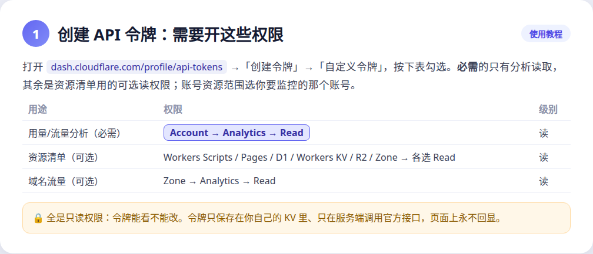
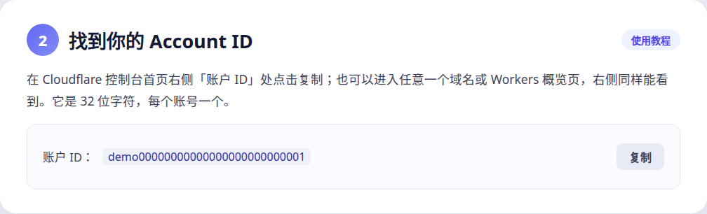
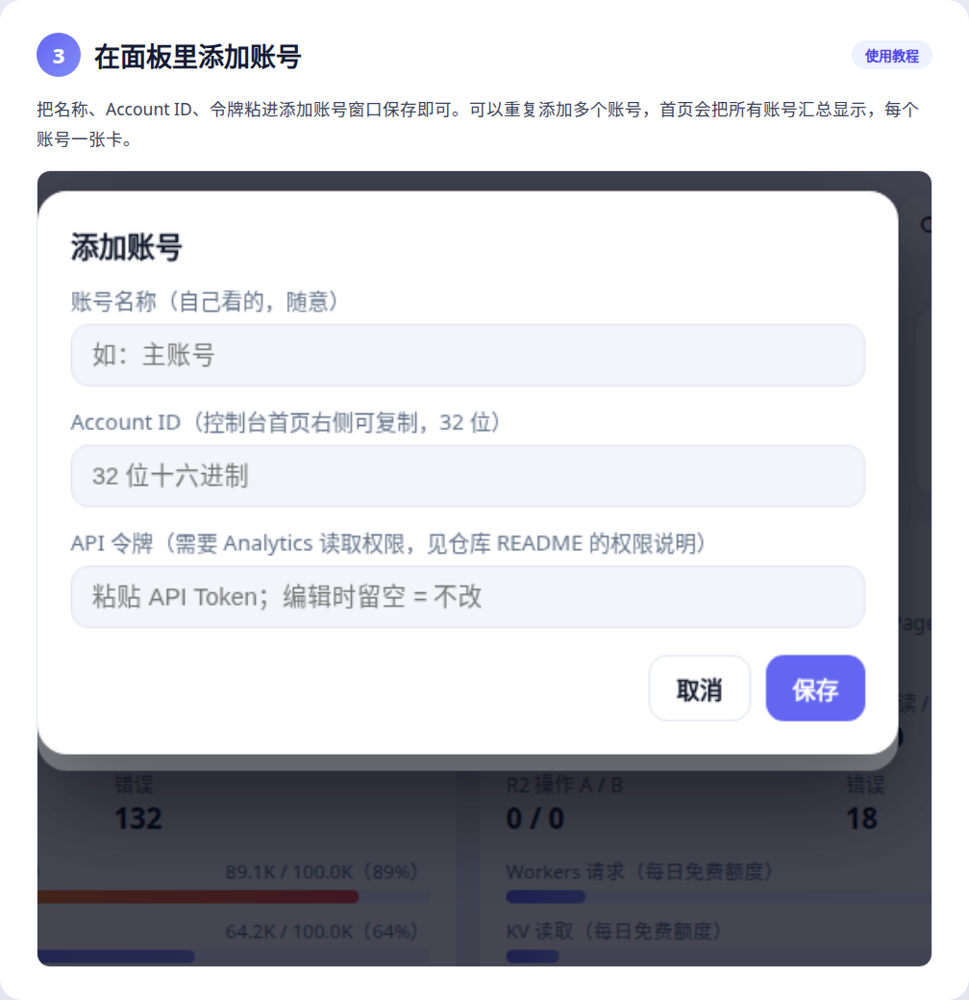
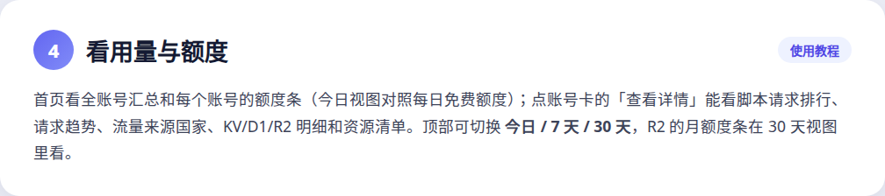


</details>

## 📖 使用方法

1. 登录后点右上角「账号管理」→「＋ 添加账号」，填名称、Account ID、API 令牌（保存时自动验令牌）。
2. 首页：顶部是所有账号的汇总；每张账号卡显示核心数字和今日额度条；点「查看详情」进入单账号页。
3. 详情页：脚本请求排行与趋势、流量与来源国家、KV / D1 / R2 明细（分别按命名空间、数据库、存储桶拆分）、资源清单。
4. 顶部可切 **今日 / 7 天 / 30 天**；数据在服务端缓存 2 分钟，点右上角 ⟳ 强制刷新。
5. 「账号管理 → 面板设置」：改面板名称、改管理员密码；可开启「未登录公开今日汇总」（只显示各产品今日总数，不含账号名与明细）。

## 💰 免费额度参考（面板进度条的依据）

| 产品 | 免费额度 | 面板里在哪看 |
| --- | --- | --- |
| Workers 请求 | 10 万次 / 天 | 今日视图 · 账号卡与详情 |
| KV 读取 / 写入 / 删除 / 列出 | 10 万 / 1000 / 1000 / 1000 次 / 天 | 今日视图 · 详情 |
| D1 行读取 / 行写入 | 500 万 / 10 万行 / 天 | 今日视图 · 详情 |
| D1 存储 | 合计 5 GB | 详情 · D1 区 |
| R2 A 类 / B 类操作 | 100 万 / 1000 万次 / 月 | 30 天视图 · 详情 R2 区 |
| R2 存储 | 10 GB（出站流量免费） | 30 天视图 · 详情 R2 区 |

额度为免费版公开标准，仅供参考，实际以 Cloudflare 官方控制台为准；用量数据来自官方分析接口，为采样统计，与账单口径可能有细微差异。

## 🔄 升级版本（更新代码）

你的账号、令牌、设置都存在 **KV** 里，升级只换代码、**不会动数据**，也不要删除 KV 命名空间或改 `PANEL_KV` 绑定名。

**方式一用户（Git 连接）**：打开你 Fork 的仓库 →「Sync fork」→「Update branch」同步新版，Pages 会自动重新部署；或本地改完 `git push`。
**方式二用户（直接上传）**：下载新版仓库压缩包，重新上传部署一遍即可（KV 绑定保持不变）。

升完打开面板验证：能登录、账号数量对、随便点一个账号能拉到数据。出问题时到 Pages「部署」页把上一个正常版本「回滚到此部署」。

<details>
<summary>📸 升级图片教程（点开看图，4 步）</summary>


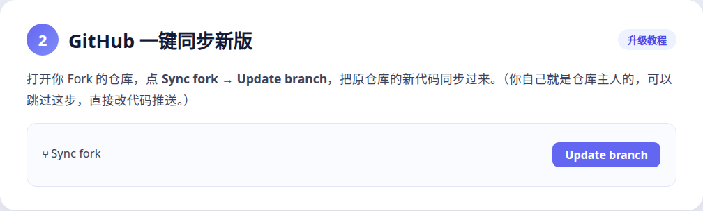
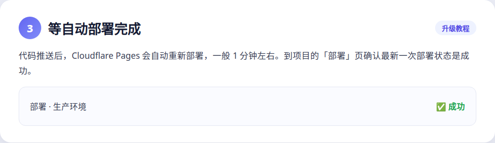


</details>

## ❓ 常见问题

**打开面板提示初始化失败？**
KV 没绑或变量名不是 `PANEL_KV`。到 Pages 项目设置里检查绑定，改完重新部署。

**某个账号整卡拉取失败？**
多半是令牌失效或 Account ID 填错。编辑该账号重新粘贴令牌（保存时会自动验证）。

**只有个别区块报错（如资源清单为空）？**
令牌缺对应产品的 Read 权限。补上权限或重新建令牌后，在账号编辑里换上新令牌。

**Pages 函数请求是怎么统计的？**
Pages 项目的函数调用在官方统计里属于名为 `pages-worker--…` 的脚本，本面板自动把它们拆出来单列；纯静态的 Pages 访问不计入 Workers 请求（在「站点流量」里能看到）。

**额度进度条为什么 7 天视图没有？**
每日额度按天看才准确，所以进度条只在「今日」视图显示；R2 是月额度，只在「30 天」视图显示。

**数据多久更新？**
服务端缓存 2 分钟；官方分析数据本身也有几分钟延迟。点 ⟳ 可强制刷新。

## 🔐 隐私与安全

- 本仓库是纯代码，**不包含任何人的账号、令牌或域名数据**；预览图与教程全部使用演示数据。
- 你添加的账号令牌只保存在**你自己部署的 KV** 中，只由服务端转发到 `api.cloudflare.com`，浏览器端永远拿不到令牌原文（列表里只显示末 4 位）。
- 管理员密码以盐值 SHA-256 哈希存储，会话用 HttpOnly Cookie；「公开汇总」默认关闭。
- 建议给面板绑定自己的域名并开启 Cloudflare Access 或保持密码强度，避免后台暴露在公网被扫。

## 🗺️ 路线图

- Workers 单文件部署版（`_worker.js`，多一种部署方式）
- 异常用量提醒（额度超阈值推送）
- 域名级流量下钻与 DNS 记录速览

## 🙏 参考与致谢

本项目在设计上参考了同类开源面板的思路（多账号用量统计、免费额度对照），代码为独立实现：[CF-Workers-UsagePanel](https://github.com/cmliu/CF-Workers-UsagePanel)、CloudFlare Assistant 的账户分析概览。用量数据均来自 Cloudflare 官方 GraphQL 分析接口与 REST API。
